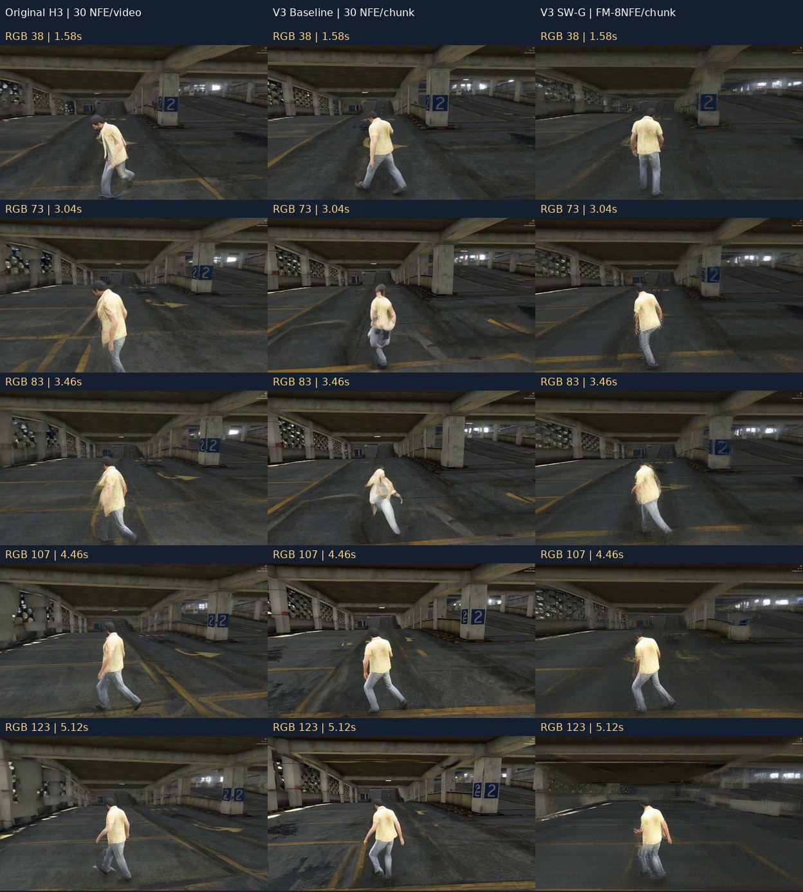

# Original H3-World 与 V3 因果版本：视频、耗时、显存与连续性

**2026-10-13 更新：[EXP-018 从首窗重新生成的统一 V0–V4 成本与视频](../unified_5s/README.md)已完成。** 本页保留较早分散证据及其统计口径，不用旧数据替代新基准。

2026-10-12，Judge整理已有冻结证据。**当前结论：因果生成、历史KV复用和基本动作/结构可行；视觉连续性仍为PARTIAL，尚未完成与Original同口径的从零端到端速度对照。** 本页新增内容仅为CPU视频拼接和证据汇总，0 GPU推理、0训练。

## 1. 直接看对比视频

| 要看什么 | 直接打开 | 范围与左右顺序 |
| --- | --- | --- |
| 原版与正式因果基线 | [Original / V3 Baseline：AA124并排](../v3/v3_baseline/videos/Original_vs_V3_Baseline_AA_124.mp4) | 左Original整片30 NFE；右V3每块FM-30NFE；持续A，124帧、24fps |
| 原版与当前低成本候选 | [Original / V3-SW-G + FM-8NFE：共同124帧并排](videos/Original_vs_V3_SWG_FM-8NFE_A_common124.mp4) | 左Original；右EXP-006/010生成的FM-8NFE候选；后者完整源片158帧，本对比仅取前124帧 |
| 真正触发滑窗淘汰后的完整结果 | [FM-8NFE A158](../v3/fm2anyflow/fm8/videos/A_rollout_158.mp4) · [晚切D158](../v3/fm2anyflow/fm8/videos/D_rollout_158.mp4) | C7/C8才进入淘汰后的生成；不能只看上面的124帧节选证明滑窗效果 |
| 30 NFE与8 NFE的长程候选 | [SW-G 30 / 8 NFE，A158](../v3/fm2anyflow/fm8/videos/A_SWG30_vs_FM8_SWG8_158.mp4) · [D158](../v3/fm2anyflow/fm8/videos/D_SWG30_vs_FM8_SWG8_158.mp4) | 相同研究输入协议，各自生成历史；不是同KV的单状态消融 |

**[浏览器播放入口](../index.html)** 已将前两项直接放在页面顶部。原速播放，未补帧、循环或延长Original；新片黄色边框提示因果块边界。Original匹配A→D的参考片仍缺失，因此没有将持续D片拼成切换对照。

### 三种方法的代表帧

左：Original；中：V3正式基线；右：V3-SW-G + FM-8NFE。选取RGB38、73、83、107、123，包含边界和已知形变位置。它是代表帧索引，质量判定依据下文已有逐帧审核。

## 2. “借鉴SolarWM的causal版本”具体指什么

| 版本 | 推理与缓存协议 | 角色 |
| --- | --- | --- |
| Original H3-World | 整片双向联合去噪，30 NFE/整片，无持久因果video KV | 原版能力参考 |
| V3 Baseline | strict chunk-causal + persistent raw KV + Global RoPE，FM-30NFE/chunk | 正式冻结参考，124帧 |
| V3-SW-G | 在V3上保留最近5个历史chunks并真实淘汰，Global RoPE | 滑窗候选，158帧有限验证 |
| V3-SW-G + FM-8NFE | 同因果/KV/Global路线，从首窗起每块8 NFE | 当前值得保留的低成本候选，158帧有限验证；尚未替代正式基线 |

借鉴的是SolarWM的因果分块、raw KV复用及滑窗思路，并针对H3原生条件/routing实现与核验。这里仍是 **Original H3 + released Action LoRA，零新增训练**；没有把SolarWM官方已训练的Stage2 student、Sliding Local RoPE或DMD能力算进来。AnyFlow的AF-train-32updates是另一训练尝试，未证实整体优于普通FM；V4-DMD当前生成失败。

## 3. 推理耗时与峰值显存

显存统一使用GiB（1 GiB = 1024 MiB），优先报告`torch.cuda.max_memory_allocated`；它不等于nvidia-smi设备占用，也不包含CPU KV。以下各行统计范围不同，分别报告，不作统一速度排名。

| 方案 / 已测范围 | Sampling耗时 | 已记录阶段总耗时 | 显存峰值与范围 |
| --- | --- | --- | --- |
| Original：从零生成124帧 | 整片369.82 s；30 NFE/整片 | **478.45 s**，原记录含共享setup；VAE decode 12.24 s | 采样allocated **38.68 GiB**；原记录全流程peak **38.99 GiB** |
| V3 Baseline：73→124帧增量，C4–C6 | AA每块 **148.45 / 176.43 / 200.42 s**；AD约148.94 / 176.66 / 199.43 s | AA **798.95 s**、AD **773.32 s**；含加载、I/O、解码、保存和人工review等待 | 已记录新增块allocated最大 **26.25 GiB**；初始commit精确峰值缺项，不能称完整进程峰值 |
| V3-SW-G，FM-30NFE：共同124→两路158 | C7/C8每块 **177.6–208.6 s** | **1068.67 s**，A/D两分支合计，不含已有124帧 | 本次续写allocated峰 **26.12 GiB** |
| FM-8NFE：新首窗及AA/AD73，EXP-006 | 首39帧 **47.21 s**；C2/C3每块 **38.98–50.05 s** | **492.86 s**，共享首窗和两分支的任务合计 | 本任务allocated峰 **26.06 GiB** |
| V3-SW-G + FM-8NFE：73→共同124→两路158，EXP-010 | C4–C8每块 **45.69–60.41 s** | **1137.11 s**，包含两分支、重复加载/I/O；不含已有73帧 | 本任务allocated峰 **26.60 GiB** |

**这些记录支持“少步候选的每块采样成本较低”的观察；尚不能给出Original→V3完整E2E加速倍数或统一显存下降比例。** Original整片30次求值与V3每块30次求值计算范围不同，历史复用、offload、采样backend和加载/等待边界也须一起核对。

每个后续chunk仅新增17帧（24fps下约0.708秒视频）。FM-8NFE后续块采样仍需约46–60秒，且还有commit/decode/I/O，因此**当前不是实时生成**。EXP-006首39帧文件可用时间代理为91.39秒；交互首帧显示延迟未测。

### FM-8NFE长程候选的逐块分解

| 块 | sampling / s | clean commit / s | decode / s |
| --- | ---: | ---: | ---: |
| C4 | 45.69 | 6.59 | 8.03 |
| C5 | 48.83 | 7.34 | 9.70 |
| C6 | 52.86 | 7.56 | 10.93 |
| A C7 | 47.83 | 7.09 | 11.81 |
| A C8 | 48.96 | 0 | 13.33 |
| D C7 | 48.54 | 7.18 | 11.81 |
| D C8 | 60.41 | 0 | 13.60 |

已有C3的clean commit另计13.01秒；C8为末块不再commit。sampling中的CPU→GPU KV搬运不重复加总。SW-G历史video KV淘汰后保持 **14,164,800,000 bytes = 13.19 GiB CPU内存**；正式Baseline最后块前为18.131 GB。prefix、完整输出、VAE和进程RSS不能据此写成恒定内存。

## 4. 视频质量与视觉连续性

| 方案 | 人物/场景与动作 | 连续性、ghosting及限制 |
| --- | --- | --- |
| Original | 提供人物结构与持续A/D动作的正控 | 原生长片也有几何变形；本页没有与causal统一的盲评/质量分数 |
| V3 Baseline | AA/AD自身历史124帧中，人物和停车场总体可辨，动作方向保留 | AA RGB79–86明显人体形变、游离肢体残影，后续恢复；AD91–92短暂异常；边界姿态跳变，质量/连续性PARTIAL |
| SW-G，FM-30NFE | 淘汰后A/D方向与首次切换响应可辨，主体/场景可用 | A C8短暂拖影；D边界姿态/镜头跳变，C8半透明拖影；PARTIAL |
| SW-G + FM-8NFE | A158可辨；晚切D在第二块反向更清楚 | 透明腿部残影、视角/车库几何边界变化；D首切换块响应弱，质量、连续性和即时切换均PARTIAL |

**“已生成历史RGB逐值不回改”是缓存/发布正确性；“新旧chunk衔接自然”是视觉连续性。前者通过不代表后者通过。**

已有连续性数值包括块边界灰度MAD与块内MAD，数值越大表示像素变化越大，但会受正常动作/镜头运动影响，不能直接当作质量评分或跨方法排名：

| 样本 | 边界MAD | 块内MAD | 审核观察 |
| --- | ---: | ---: | --- |
| V3 Baseline AA C4 | 13.82 | 5.44 | 边界/人体异常，RGB79–86形变 |
| SW-G 30 NFE，D C8 | 16.97 | 4.94 | 切换后的跳变与持续透明拖影 |
| SW-G FM-8NFE，A C7 | 12.30 | 3.56 | 边界视角变化与拖腿 |
| SW-G FM-8NFE，D C7 | 12.59 | 3.28 | 切换响应弱、边界位移 |

这些是各自输出上的描述量，历史/动作条件不同，不是同状态配对质量测量。目前没有Original与全部V3候选统一的FVD、感知质量评分或盲评结果；已有PSNR属于真实数据VAE重建，不能移作生成视频质量指标。

## 5. 原始证据与尚缺项

- [Original耗时原始JSON副本](evidence/original_timing.json)：对应本页Original视频；NVIDIA L40，30 NFE、124帧。
- [V3 Baseline逐块效率表](../../experiments/EXP-003_native_cached_124/efficiency_table.md) · [原始指标](../../experiments/EXP-003_native_cached_124/metrics.json) · [正式审核](../../experiments/EXP-003_native_cached_124/judge/FINAL_REVIEW.md)。
- [SW-G 30 NFE计时与质量](../../experiments/EXP-005_v3_sliding_window/stage2/G1_RESULT.md)。
- [FM-8NFE首窗/73帧审核](../../experiments/EXP-006_v3_fm8_full/judge/FINAL_REVIEW.md) · [首屏计时口径](../../experiments/EXP-006_v3_fm8_full/judge/latency_scope.json)。
- [FM-8NFE滑窗逐块成本](../../experiments/EXP-010_v3_fm8_sw158/judge/FINAL_REVIEW.md) · [机器审计](../../experiments/EXP-010_v3_fm8_sw158/judge/branch_audit.json) · [完整新增帧质量记录](../../experiments/EXP-010_v3_fm8_sw158/judge/visual_notes.json)。
- [本页数值摘录](summary_metrics.json) · [视频来源、SHA与解码检查](video_manifest.json) · [CPU拼接脚本](build_comparison.py)。

仍缺：匹配Original A→D对照、Original与causal同条件从零完整E2E/交互首帧测量，以及统一质量评测。本次复用已有产物，没有为补汇报启动新的GPU实验。后续若要量化加速收益，应独立冻结同一硬件、分辨率、帧数、动作、首窗处理、加载/offload策略和计时边界，按正式任务书执行。
