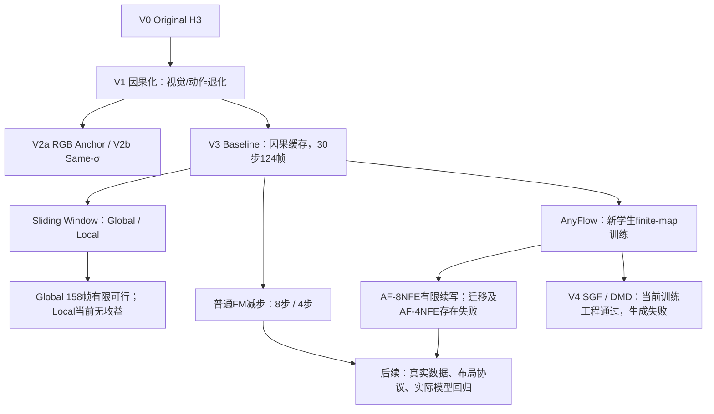

# 研究路线：V3因果缓存、少步生成与V4 SGF

箭头表示研究关系。V2a/V2b/V3不是连续权重继承；具体EXP-008 DMD学生继承EXP-007 AF AF-train-32updates。正式V3 Baseline保持原权重与协议，V4为SGF研究分类，当前没有已验收生成模型。

[Sliding Window](v3/sliding_windows/README.md) · [FM → AnyFlow](v3/fm2anyflow/README.md) · [V4 SGF / DMD](v4/README.md) · [下一步草案](02_next_steps/README.md)
